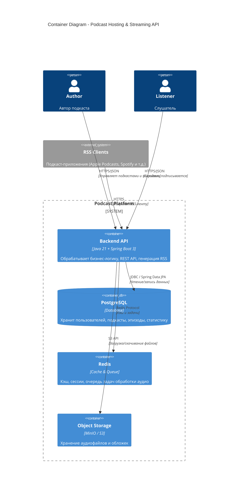
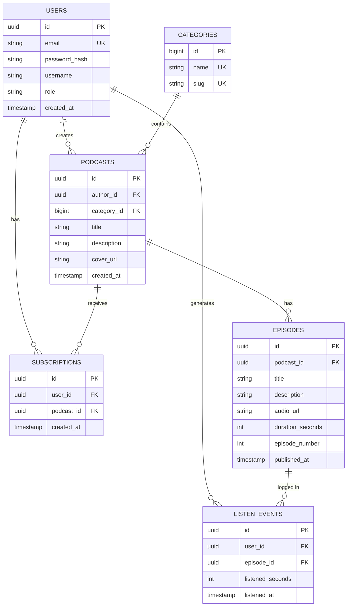

# Архитектура проекта: Podcast Hosting & Streaming API

## 1. Описание проекта

**Название:** Podcast Hosting & Streaming API  

**Краткое описание:**  
Серверное API для платформы хостинга подкастов. Авторы загружают аудиоэпизоды, система формирует RSS-ленту и собирает статистику прослушиваний. Слушатели потребляют контент через API или RSS.

**Технологии:** Java 21, Spring Boot 3, PostgreSQL, Redis, MinIO/S3.

## 2. Ролевая модель и Use Cases

### Роли

| Роль              | Описание                                      |
|-------------------|-----------------------------------------------|
| **Author**        | Автор подкаста. Создаёт подкасты и эпизоды.   |
| **Listener**      | Слушатель. Просматривает и слушает контент.   |

### Use Cases

#### Author
1. Регистрация / вход в систему
2. Создание подкаста (название, описание, обложка, категория)
3. Редактирование информации о подкасте
4. Загрузка аудиофайла эпизода + метаданные (название, описание, номер)
5. Редактирование / удаление эпизода
6. Просмотр статистики прослушиваний своего подкаста/эпизодов
7. Получение RSS-ссылки на подкаст

#### Listener
1. Регистрация / вход в систему
2. Просмотр каталога подкастов (поиск, фильтр по категориям)
3. Просмотр страницы подкаста и списка эпизодов
4. Подписка / отписка от подкаста
5. Прослушивание эпизода (запрос потока / URL файла)
6. Просмотр истории своих прослушиваний

## 3. Список сущностей (Domain Model)

Минимальный набор ключевых сущностей (≥ 5):

1. **User** — пользователь системы (может быть автором и/или слушателем)
2. **Podcast** — подкаст
3. **Episode** — эпизод подкаста
4. **Category** — категория подкаста
5. **Subscription** — подписка слушателя на подкаст
6. **ListenEvent** — факт прослушивания (для статистики)

## 4. C4 Container Diagram (Level 2)

## 5. ER-диаграмма базы данных (3NF)

## 6. REST API Specs

| Метод | URI | Описание | Доступ (роль) | Ожидаемый код |
|---|---|---|---|---|
| **POST** | `/api/v1/auth/register` | Регистрация нового пользователя | Все | `201 Created` |
| **POST** | `/api/v1/auth/login` | Вход и получение JWT-токена | Все | `200 OK` |
| **GET** | `/api/v1/podcasts` | Получение списка подкастов (с фильтром по категории) | Все | `200 OK` |
| **POST** | `/api/v1/podcasts` | Создание нового подкаста | Author | `201 Created` |
| **GET** | `/api/v1/podcasts/{id}` | Получение информации о конкретном подкасте | Все | `200 OK` |
| **GET** | `/api/v1/podcasts/{podcastId}/episodes` | Получение списка эпизодов подкаста | Все | `200 OK` |
| **POST** | `/api/v1/podcasts/{podcastId}/episodes` | Загрузка/создание нового эпизода | Author (Владелец) | `201 Created` |
| **DELETE** | `/api/v1/episodes/{id}` | Удаление эпизода | Author (Владелец) | `204 No Content` |
| **POST** | `/api/v1/podcasts/{podcastId}/subscribe` | Подписка на подкаст | Listener | `201 Created` |
| **DELETE** | `/api/v1/podcasts/{podcastId}/subscribe` | Отписка от подкаста | Listener | `204 No Content` |